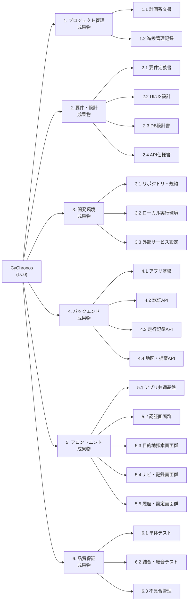

# CyChronos 成果物型WBS(Deliverable-oriented WBS)

- 対象プロダクト: **CyChronos**(3年チーム制作・前期)
- 作成日: 2026-07-31
- 分解方針: **成果物(何が出来上がるか)基準**で分解。最下位(Lv.3)を1つのワークパッケージとし、各行が「完成物」1点に対応する

---

## 0. プロダクト概要(WBSの前提)

「**空き時間から、自転車で行ける未訪問スポットを提案し、ルート案内して走行を記録する**」サイクリングナビアプリ。

| 区分 | 内容 |
|---|---|
| フロントエンド | Flutter(Dart 3.7)/ Riverpod・go_router・dio・flutter_map・geolocator |
| 認証 | Google サインイン(Firebase Authentication)→ IDトークンをバックで `firebase-admin` 検証 |
| バックエンド | Node.js / Express 5(`back/src`)、MySQL 8.4(`mysql2`) |
| DB | MySQL 8.4(Docker)/ `users`・`trip_history`・`location_log` の3テーブル |
| 外部API | Mapbox(Isochrone / Directions / Matrix)、Google Places、Open-Meteo(天気) |
| 主要ユーザーフロー | ログイン → 空き時間入力 → スポット提案 → 詳細確認 → ルート確認 → 案内開始/終了 → 走行履歴 |

### WBS ツリー(Lv.1〜Lv.2)

---

## 1. プロジェクト管理成果物

### 1.1 計画系文書

| WBS | 成果物 | 完了条件(受入基準) |
|---|---|---|
| 1.1.1 | 企画書 / コンセプトシート | プロダクトの目的・ターゲット・差別化ポイントが1枚で説明できる |
| 1.1.2 | スケジュール表(マイルストーン) | 前期の全マイルストーンと担当が確定し、チーム全員が参照できる |
| 1.1.3 | 本WBS | 全成果物が漏れなく列挙され、各行に完了条件と担当が入っている |
| 1.1.4 | 役割分担表 | 6名の担当領域(フロント/バック/DB/デザイン/資料)が明文化されている |

### 1.2 進捗管理記録

| WBS | 成果物 | 完了条件(受入基準) |
|---|---|---|
| 1.2.1 | 定例議事録 | 各回の決定事項・宿題・担当が記録され蓄積されている |
| 1.2.2 | Git 運用実績 | `main` + `feature/*` のブランチ運用とPRレビューが回っている |
| 1.2.3 | 課題・リスク管理表 | 未解決課題が起票され、優先度と期限が付いている |

---

## 2. 要件・設計成果物

### 2.1 要件定義書

| WBS | 成果物 | 完了条件(受入基準) |
|---|---|---|
| 2.1.1 | 機能要件一覧 | 全機能がID付きで列挙され、必須/任意が区別されている |
| 2.1.2 | 非機能要件一覧 | 対応OS・想定端末・性能・位置情報精度・オフライン方針が定義済み |
| 2.1.3 | ユースケース / ユーザーストーリー | 主要4フロー(ログイン・提案・案内・履歴)が文章化されている |

### 2.2 UI/UX設計

| WBS | 成果物 | 完了条件(受入基準) |
|---|---|---|
| 2.2.1 | 画面一覧 | 全9画面がID・名称・用途付きで一覧化されている |
| 2.2.2 | 画面遷移図 | 全画面の遷移とパラメータ受け渡しが図で追える |
| 2.2.3 | デザインカンプ | 全画面のカンプが確定し、実装と差分がない |
| 2.2.4 | デザイントークン(配色・書体) | 配色1系統・フォント4種が実装に反映されている |
| 2.2.5 | アプリアイコン / スプラッシュ | アイコン・スプラッシュ画像が全プラットフォームに設定済み |

### 2.3 DB設計書

| WBS | 成果物 | 完了条件(受入基準) |
|---|---|---|
| 2.3.1 | ER図 | 3テーブルの関連・多重度・削除規則が図示されている |
| 2.3.2 | テーブル定義書 | 全カラムの型・NULL可否・既定値・索引・外部キーが記載済み |
| 2.3.3 | 初期データ / ダンプ | `docker compose up` だけでスキーマ+サンプルデータが復元される |

### 2.4 API仕様書

| WBS | 成果物 | 完了条件(受入基準) |
|---|---|---|
| 2.4.1 | エンドポイント一覧 | 全エンドポイントが引数・用途付きで表になっている |
| 2.4.2 | 各API詳細仕様 | 引数・レスポンス例・ステータスコードが全APIに記載されている |
| 2.4.3 | 仕様書の実装同期 | 実装済みの全エンドポイント(`GET /api/maps/photo` を含む)が仕様書に反映され、「仮」表記が残っていない |

---

## 3. 開発環境成果物

### 3.1 リポジトリ・規約

| WBS | 成果物 | 完了条件(受入基準) |
|---|---|---|
| 3.1.1 | Git リポジトリ構成 | `back` / `front` が分離され、`.gitignore` で秘匿情報が除外されている |
| 3.1.2 | 環境構築手順書 | 未経験者が手順どおりで起動でき、詰まりどころの対処も書かれている |
| 3.1.3 | Lint / コード規約 | Dart 側 lint が有効で、CIまたは手元で違反ゼロを維持できる |

### 3.2 ローカル実行環境

| WBS | 成果物 | 完了条件(受入基準) |
|---|---|---|
| 3.2.1 | MySQL コンテナ定義 | `docker compose up -d` で healthy になり、ポート衝突回避手段もある |
| 3.2.2 | バックエンド起動環境 | `npm run dev` で起動し、`/` と `/api/trips` が応答する |
| 3.2.3 | 環境変数テンプレート | `.env.example` をコピーするだけで必要項目が揃う |
| 3.2.4 | 実機/エミュレータ接続切替 | 実機・エミュレータ・Webで自動的に正しいAPI接続先が選ばれる |

### 3.3 外部サービス設定

| WBS | 成果物 | 完了条件(受入基準) |
|---|---|---|
| 3.3.1 | Firebase プロジェクト | Android/iOS/Web の設定が生成され、Googleサインインが通る |
| 3.3.2 | Mapbox アクセストークン | Isochrone / Directions / Matrix が本番トークンで動作する |
| 3.3.3 | Google Places APIキー | Nearby Search / Photo が動作し、課金上限が設定されている |

---

## 4. バックエンド成果物

### 4.1 アプリ基盤

| WBS | 成果物 | 完了条件(受入基準) |
|---|---|---|
| 4.1.1 | Express アプリ本体 | ルーターがマウントされ、404・500の共通エラー応答が返る |
| 4.1.2 | DB接続プール | `.env` の接続情報でプール接続し、全ルートから利用できる |
| 4.1.3 | 外部APIキャッシュ | 同一条件の外部API呼び出しがキャッシュされ、単体テストで検証済み |

### 4.2 認証API

| WBS | 成果物 | 完了条件(受入基準) |
|---|---|---|
| 4.2.1 | IDトークン検証ミドルウェア | 不正・欠落トークンで 401 を返す |
| 4.2.2 | アカウント作成 API | `POST /api/auth/register`。重複は409、論理削除済みは再有効化 |
| 4.2.3 | ログイン API | `POST /api/auth/login`。プロフィール同期、未登録は404 |
| 4.2.4 | 全APIの認可統一 | 認証系以外のAPIもIDトークンを検証し、他ユーザーのデータを読み書きできない |

### 4.3 走行記録API

| WBS | 成果物 | 完了条件(受入基準) |
|---|---|---|
| 4.3.1 | トリップ開始 API | `POST /api/trips/start` が `trip_id` を採番して返す |
| 4.3.2 | トリップ終了 API | `POST /api/trips/{id}/end` が `completed` に更新する |
| 4.3.3 | 座標保存 API | `POST /api/locations` が連番採番して保存し、他人のトリップは404 |
| 4.3.4 | 履歴取得 API(一覧/単体) | `GET /api/trips`、`GET /api/trips/{id}`(座標ログ込み)が返る |
| 4.3.5 | 履歴削除 API | `DELETE /api/trips/{id}` が論理削除し、取得系から消える |
| 4.3.6 | 走行実績の集計処理 | 座標ログから距離・時間・平均速度を算出し、`total_distance_m` / `duration_sec` / `average_speed_kmh` が確定値で保存される |

### 4.4 地図・提案API

| WBS | 成果物 | 完了条件(受入基準) |
|---|---|---|
| 4.4.1 | 到達圏取得 API | `GET /api/maps/isochrone` が GeoJSON を返す(60分超は距離近似) |
| 4.4.2 | 自転車ルート取得 API | `GET /api/maps/route` が経路形状・距離・時間を返す |
| 4.4.3 | 周辺スポット検索 API | `GET /api/maps/places` が不適格カテゴリを除外して整形返却する |
| 4.4.4 | スポット写真プロキシ API | `GET /api/maps/photo` が写真を中継する |
| 4.4.5 | スポット提案 API | `GET /api/suggest` が到達圏→検索→所要時間付与→訪問済み除外まで通しで動く |
| 4.4.6 | 提案ロジックの確定 | レスポンス形式をフロントと合意して凍結し、以降の破壊的変更がない |

---

## 5. フロントエンド成果物

### 5.1 アプリ共通基盤

| WBS | 成果物 | 完了条件(受入基準) |
|---|---|---|
| 5.1.1 | アプリエントリポイント | Firebase 初期化 → API接続先確定 → ルーター起動まで通る |
| 5.1.2 | ルーティング定義 | 全9ルートが定義され、認証状態でリダイレクトされる |
| 5.1.3 | HTTP クライアント | 共通 baseUrl・タイムアウトを持つ dio インスタンス |
| 5.1.4 | テーマ定義 | 配色・書体が全画面で共通適用されている |
| 5.1.5 | 共通ウィジェット | 下部ナビバー・PCプレビュー用フレームが全画面で統一されている |

### 5.2 認証画面群

| WBS | 成果物 | 完了条件(受入基準) |
|---|---|---|
| 5.2.1 | スプラッシュ画面 | 起動時にログイン状態を判定し、適切な画面へ遷移する |
| 5.2.2 | ログイン画面 | Googleサインインが成功し、`/home` に遷移する |
| 5.2.3 | 認証データ層・状態管理 | 登録/ログインAPIを呼び分け、`user_id` を保持できる |

### 5.3 目的地探索画面群

| WBS | 成果物 | 完了条件(受入基準) |
|---|---|---|
| 5.3.1 | ホーム画面 | 現在地取得 → 空き時間入力 → 提案取得 → 一覧へ遷移できる |
| 5.3.2 | 天気カード | 現在地の気温・湿度・風速・天候が表示される(Open-Meteo) |
| 5.3.3 | 提案データ層 | `/api/suggest` を呼び、候補リストを状態として保持する |
| 5.3.4 | 目的地一覧画面 | ジャンル絞り込み・写真表示・カード展開・自動スクロールが動く |
| 5.3.5 | 目的地詳細画面 | 写真・住所・ジャンル・所要時間・距離・評価が表示される |

### 5.4 ナビ・記録画面群

| WBS | 成果物 | 完了条件(受入基準) |
|---|---|---|
| 5.4.1 | ルート確認画面 | 現在地→目的地のルートが地図描画され、距離・時間が出る |
| 5.4.2 | ルートデータ層 | ルート取得・トリップ開始・トリップ終了APIを呼べる |
| 5.4.3 | 案内モード | 案内開始でフルスクリーン化し、終了でトリップが `completed` になる |
| 5.4.4 | 走行中GPSログ送信 | 案内中に一定間隔で `POST /api/locations` を呼び、`location_log` に走行軌跡が蓄積される |
| 5.4.5 | 走行中ナビ画面(専用画面) | 現在地追従・残距離/残時間・逸脱時の再取得を持つ案内専用画面 |

### 5.5 履歴・設定画面群

| WBS | 成果物 | 完了条件(受入基準) |
|---|---|---|
| 5.5.1 | 走行履歴画面 | 実データのトリップ一覧が新しい順に表示され、距離・時間・平均速度が実数値で出る |
| 5.5.2 | 履歴データ層 | `/api/trips` を呼び、想定外データを安全に読み飛ばす |
| 5.5.3 | 履歴詳細 / 走行軌跡表示 | 1件の走行の座標ログを地図に描画する |
| 5.5.4 | 設定画面 | プロフィール表示・各種設定項目・ログアウトが動作する |
| 5.5.5 | お問い合わせ画面 | 入力内容が実際に送信され、送信結果がユーザーに返る |
| 5.5.6 | 履歴削除機能(UI) | 一覧から不要なトリップを削除できる |

---

## 6. 品質保証成果物

### 6.1 単体テスト

| WBS | 成果物 | 完了条件(受入基準) |
|---|---|---|
| 6.1.1 | バックエンド単体テスト | `npm test` が通り、主要ルート(trips / locations / auth)と整形・キャッシュ処理が検証されている |
| 6.1.2 | フロント ウィジェットテスト | `flutter test` が通り、主要画面の描画・遷移が検証されている |
| 6.1.3 | API動作確認用ページ | 各APIをブラウザから手動実行して応答を確認できる |

### 6.2 結合・総合テスト

| WBS | 成果物 | 完了条件(受入基準) |
|---|---|---|
| 6.2.1 | テスト仕様書(項目表) | 全画面・全APIの確認項目が網羅され、期待値が書かれている |
| 6.2.2 | 結合テスト結果報告 | ログイン〜提案〜案内〜履歴の通しシナリオが実施・記録済み |
| 6.2.3 | 実機動作確認記録 | Android実機で位置情報・地図・GPSログが動作することを確認済み |
| 6.2.4 | 異常系確認記録 | 圏外・位置情報拒否・外部API失敗(502)時の挙動を確認済み |

### 6.3 不具合管理

| WBS | 成果物 | 完了条件(受入基準) |
|---|---|---|
| 6.3.1 | 不具合管理表 | 検出バグが起票・優先度付け・修正確認まで追跡できる |
