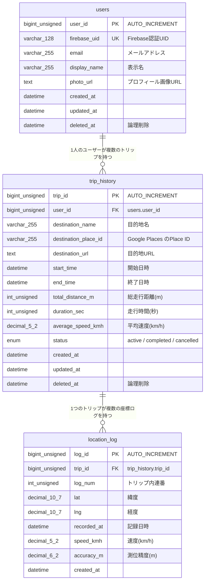

# CyChronos DB設計書

- DBMS: MySQL 8.4
- データベース名: `cychronos`
- 文字コード / 照合順序: `utf8mb4` / `utf8mb4_unicode_ci`
- ストレージエンジン: InnoDB
- 削除方針: `users`・`trip_history` は論理削除(`deleted_at`)。`location_log` は親トリップの物理削除時にCASCADEで削除される

## ER図

リレーション:

| 親 | 子 | 多重度 | 外部キー | 削除時 / 更新時 |
|---|---|---|---|---|
| users | trip_history | 1 : N | `fk_trip_history_user` (user_id) | RESTRICT / CASCADE |
| trip_history | location_log | 1 : N | `fk_location_log_trip` (trip_id) | CASCADE / CASCADE |

---

## テーブル定義書

### 1. users(ユーザー)

Firebase認証と連携するアプリ利用者の情報。

| # | カラム名 | 型 | NULL | デフォルト | キー | 説明 |
|---|---|---|---|---|---|---|
| 1 | user_id | bigint unsigned | NOT NULL | AUTO_INCREMENT | PK | ユーザーID |
| 2 | firebase_uid | varchar(128) | NOT NULL | - | UK | Firebase認証のUID |
| 3 | email | varchar(255) | NULL | NULL | | メールアドレス |
| 4 | display_name | varchar(255) | NULL | NULL | | 表示名 |
| 5 | photo_url | text | NULL | NULL | | プロフィール画像URL |
| 6 | created_at | datetime | NOT NULL | CURRENT_TIMESTAMP | | 作成日時 |
| 7 | updated_at | datetime | NOT NULL | CURRENT_TIMESTAMP(更新時自動) | | 更新日時 |
| 8 | deleted_at | datetime | NULL | NULL | | 論理削除日時(NULL=有効) |

インデックス:

| 名前 | 種類 | 対象カラム |
|---|---|---|
| PRIMARY | 主キー | user_id |
| uq_users_firebase_uid | ユニーク | firebase_uid |
| idx_users_deleted_at | 通常 | deleted_at |

### 2. trip_history(走行履歴)

1回のサイクリング(トリップ)の記録。開始APIで作成され(`status='active'`)、終了APIで `completed` になる。

| # | カラム名 | 型 | NULL | デフォルト | キー | 説明 |
|---|---|---|---|---|---|---|
| 1 | trip_id | bigint unsigned | NOT NULL | AUTO_INCREMENT | PK | トリップID |
| 2 | user_id | bigint unsigned | NOT NULL | - | FK | 所有ユーザー(users.user_id) |
| 3 | destination_name | varchar(255) | NOT NULL | - | | 目的地名(未設定時は空文字) |
| 4 | destination_place_id | varchar(255) | NULL | NULL | | 目的地のGoogle Places Place ID |
| 5 | destination_url | text | NULL | NULL | | 目的地の参考URL |
| 6 | start_time | datetime | NOT NULL | - | | 走行開始日時 |
| 7 | end_time | datetime | NULL | NULL | | 走行終了日時(走行中はNULL) |
| 8 | total_distance_m | int unsigned | NULL | NULL | | 総走行距離(メートル) |
| 9 | duration_sec | int unsigned | NULL | NULL | | 走行時間(秒) |
| 10 | average_speed_kmh | decimal(5,2) | NULL | NULL | | 平均速度(km/h) |
| 11 | status | enum('active','completed','cancelled') | NOT NULL | 'active' | | トリップ状態 |
| 12 | created_at | datetime | NOT NULL | CURRENT_TIMESTAMP | | 作成日時 |
| 13 | updated_at | datetime | NOT NULL | CURRENT_TIMESTAMP(更新時自動) | | 更新日時 |
| 14 | deleted_at | datetime | NULL | NULL | | 論理削除日時(NULL=有効) |

インデックス:

| 名前 | 種類 | 対象カラム |
|---|---|---|
| PRIMARY | 主キー | trip_id |
| idx_trip_history_user_start | 通常 | user_id, deleted_at, start_time |
| idx_trip_history_status | 通常 | status |
| idx_trip_history_user_destination_place | 通常 | user_id, destination_place_id |

外部キー:

| 名前 | カラム | 参照先 | ON DELETE | ON UPDATE |
|---|---|---|---|---|
| fk_trip_history_user | user_id | users.user_id | RESTRICT | CASCADE |

### 3. location_log(座標ログ)

走行中にナビ画面から一定間隔で送信されるGPS座標の記録。論理削除カラムは持たず、削除はトリップ単位(`trip_history.deleted_at`)で管理する。

| # | カラム名 | 型 | NULL | デフォルト | キー | 説明 |
|---|---|---|---|---|---|---|
| 1 | log_id | bigint unsigned | NOT NULL | AUTO_INCREMENT | PK | ログID |
| 2 | trip_id | bigint unsigned | NOT NULL | - | FK | 所属トリップ(trip_history.trip_id) |
| 3 | log_num | int unsigned | NOT NULL | - | UK(複合) | トリップ内の連番(1始まり・API側で自動採番) |
| 4 | lat | decimal(10,7) | NOT NULL | - | | 緯度(-90〜90) |
| 5 | lng | decimal(10,7) | NOT NULL | - | | 経度(-180〜180) |
| 6 | recorded_at | datetime | NOT NULL | - | | 記録日時(APIのサーバー受信時刻) |
| 7 | speed_kmh | decimal(5,2) | NULL | NULL | | 記録時点の速度(km/h) |
| 8 | accuracy_m | decimal(6,2) | NULL | NULL | | GPS測位精度(メートル) |
| 9 | created_at | datetime | NOT NULL | CURRENT_TIMESTAMP | | 作成日時 |

インデックス:

| 名前 | 種類 | 対象カラム |
|---|---|---|
| PRIMARY | 主キー | log_id |
| uq_location_log_trip_log_num | ユニーク | trip_id, log_num |
| idx_location_log_trip_recorded_at | 通常 | trip_id, recorded_at |

外部キー:

| 名前 | カラム | 参照先 | ON DELETE | ON UPDATE |
|---|---|---|---|---|
| fk_location_log_trip | trip_id | trip_history.trip_id | CASCADE | CASCADE |

---

## 関連ドキュメント

- APIとの対応は [`docs/API.md`](../docs/API.md) を参照
- スキーマ+サンプルデータの復元は `db/cydump.sql` を使用: `mysql -u root -p cychronos < db/cydump.sql`
